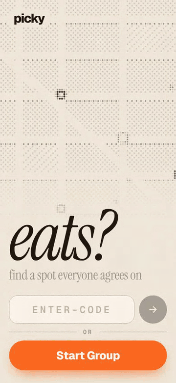

<div align="center">


# picky

**Ends the "idk, where do you want to eat?" loop.** Everyone says what they want from their own phone, and picky picks the one nearby restaurant that works for all of you.

🥈 **2nd place at Hack With Claude** · UC Berkeley, November 2026

[Try it on your phone](https://picky-ten-flax.vercel.app) · [MVP write-up (PDF)](docs/picky_MVP.pdf)

<br>



<sub>The demo uses sample restaurants.</sub>

</div>

## How it works

| | |
|---|---|
| **Start** | Start a group and share the code (like `TACO-42`) or a QR code. |
| **Pitch** | Everyone types what they want in 80 characters: diet, budget, cravings, vetoes. Go over and picky says "dont be picky 😒". |
| **Wait** | Pitches show up live on every phone as friends join, typing dots included. |
| **Find** | picky grabs real restaurants near you, and an AI picks one spot, with one line on why it works for each person. |
| **Go** | Everyone taps 👍 and gets walking directions. Tap the logo to pick again. |

## Why it's more than a chatbot

- **Everyone pitches at once,** from their own phone. Nobody has to collect the group's constraints.
- **Real places, right now:** live OpenStreetMap data near you, with distance and opening hours.
- **Shared, live state:** typing, pitches and the group vote sync across every phone.
- **It ends with an action:** one place everyone agreed to, and directions there.

## Dev mode

Type **`DEV-67`** as the group code to run every screen without spending API credits. Friends can join the test group, and Find always picks the Taco Bell on Durant Ave ("default location lol").

## Built with

| Part | What it uses |
|---|---|
| App | Next.js and React, one phone-first page |
| Live sync | Upstash Redis |
| Restaurants | OpenStreetMap data through Geoapify, with Overpass, Nominatim and Photon as backups and a 7-day cache |
| The pick | OpenAI or Claude, with a strict JSON schema; every pick is checked against the real list |
| Hosting | Vercel, built with Claude Code |

If the AI is ever unavailable, picky still finishes with the closest restaurant, so Find never gets stuck.

## Run it locally

```bash
git clone https://github.com/SmaranKudapa/picky
cd picky
npm install
cp .env.example .env.local
npm run dev   # http://localhost:3000
```

It works with no setup: the store is in memory, and without an AI key picky picks the closest place. For the full app, add your own keys to `.env.local`:

| Setting | What it's for |
|---|---|
| `OPENAI_API_KEY` | The AI pick (or `ANTHROPIC_API_KEY` for Claude) |
| `GEOAPIFY_API_KEY` | More reliable restaurant data (free tier at geoapify.com) |
| `KV_REST_API_URL`, `KV_REST_API_TOKEN` | Shared state across phones when hosted (Upstash Redis) |
| `PICKY_FAKE_PLACES=1` | Sample restaurants, to test offline |

---

<sub>Built by [Smaran Kudapa](https://github.com/SmaranKudapa) at Hack With Claude, UC Berkeley. Restaurant data © OpenStreetMap contributors.</sub>
