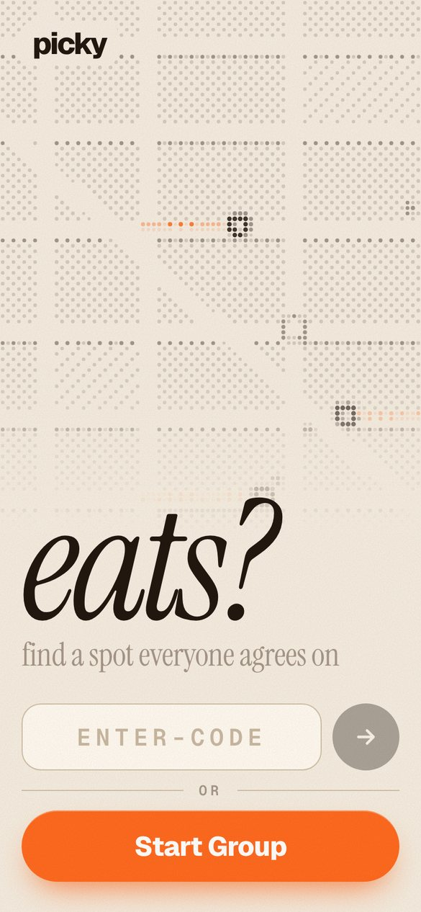
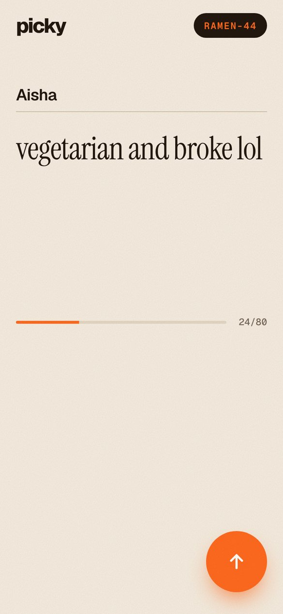
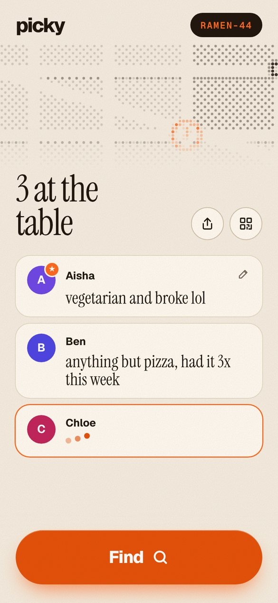
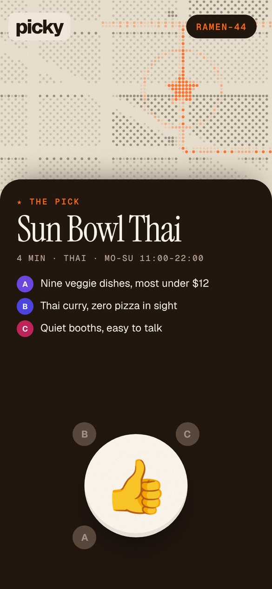
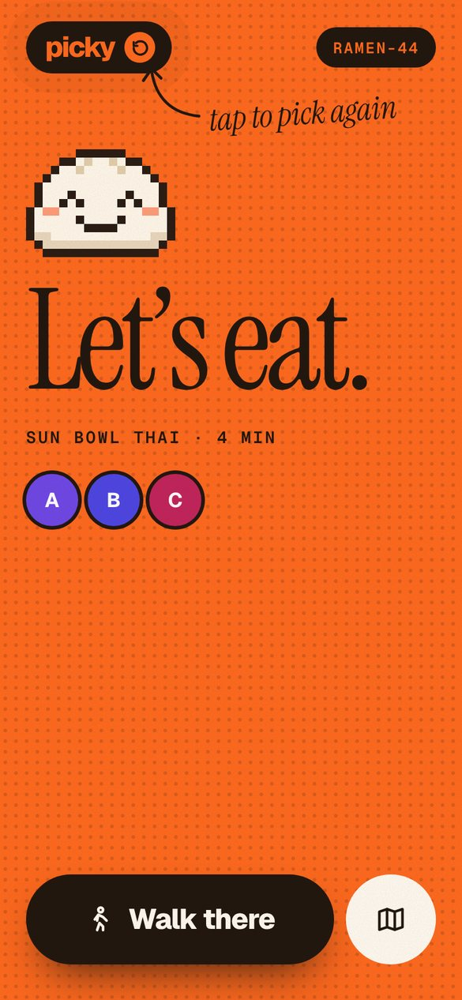

# picky

**Ends the "idk, where do you want to eat?" loop.** Everyone in your group says what they want from their own phone, and picky picks the one nearby restaurant that works for all of you, then walks you there.

🥈 **2nd place at Hack With Claude** (UC Berkeley, November 13, 2026)

**Try it:** [picky-ten-flax.vercel.app](https://picky-ten-flax.vercel.app). Open it on your phone and start a group with friends.

## Demo

<!-- DEMO VIDEO: on github.com, edit this file and drag your video file right here. GitHub uploads it and puts a link on this line that plays inline. -->
*Demo video coming soon.*

<p align="center">
  
  
  
  
  
</p>
<p align="center"><sub>Screenshots use sample restaurants.</sub></p>

## How it works

1. **Start a group.** You get a code like `TACO-42` to share, or friends can scan a QR code.
2. **Everyone pitches.** Each person types what they want in 80 characters or less: diet, budget, cravings, vetoes. Go over the limit and picky tells you "dont be picky 😒".
3. **Wait for the table.** Pitches show up live as friends join, including "is typing". Anyone can edit until the leader hits Find.
4. **Find.** picky grabs the real restaurants near the leader, and an AI weighs everyone's pitch to choose one spot. It explains in one line why the pick works for each person.
5. **Thumbs up, then go.** When everyone taps 👍, you get walking directions. Tap the picky logo to start a new round.

## Why it's more than a chatbot

- **Everyone's input at once.** Each friend pitches from their own phone, so nobody has to collect everyone's constraints and paste them somewhere.
- **Real places, right now.** Restaurants come from live OpenStreetMap data around you, with distance and opening hours.
- **Shared, live state.** Typing indicators, locked pitches and a group vote sync across every phone.
- **It ends with an action.** There's a decision everyone agreed to and directions, not just a list of suggestions.

## Dev mode

Type **`DEV-67`** as the group code to test the whole flow without spending any API credits. It creates a test group (code `DEV-xxxx`, which friends can join) that goes through every screen. Find skips the restaurant search and the AI, and always picks the Taco Bell on Durant Ave, telling everyone "default location lol".

## Tech

| Part | What it uses |
|---|---|
| App | Next.js (App Router), React, one phone-first page |
| Live sync | Upstash Redis. Phones poll every second |
| Restaurants | OpenStreetMap data through Geoapify, with Overpass, Nominatim and Photon as backups, plus a 7-day cache |
| The pick | OpenAI (Claude also supported) with a strict JSON schema. Every restaurant id is checked against the real list |
| Hosting | Vercel |
| Built with | Claude Code |

If the AI is unavailable for any reason, picky still finishes with the closest restaurant (marked "demo mode"), so a Find never gets stuck.

## Run it yourself

```bash
npm install
cp .env.example .env.local
npm run dev        # http://localhost:3000
```

Everything works locally without setup: the store is in memory, and without an AI key, picky picks the closest place. Add keys in `.env.local` for the full experience:

| Variable | What it's for |
|---|---|
| `OPENAI_API_KEY` | The AI pick (or use `ANTHROPIC_API_KEY` for Claude) |
| `GEOAPIFY_API_KEY` | More reliable restaurant data (free tier at geoapify.com) |
| `KV_REST_API_URL`, `KV_REST_API_TOKEN` | Shared state across phones when hosted (Upstash Redis) |
| `PICKY_FAKE_PLACES=1` | Made-up restaurants, so you can test offline |

## Project structure

| File | What it does |
|---|---|
| `app/page.js` | Every screen: landing, pitch, waiting room, finding, the pick, let's eat |
| `app/api/groups/` | Create a group, poll its state, save pitches, typing and thumbs, and Find |
| `lib/places.js` | Finds nearby restaurants, with backups and caching |
| `lib/pick.js` | The AI prompt, JSON schema, checks and fallback |
| `lib/dev.js` | Dev mode |

More detail is in the [MVP write-up (PDF)](docs/picky_MVP.pdf).

---

Built by [Smaran Kudapa](https://github.com/SmaranKudapa) at Hack With Claude, UC Berkeley. Restaurant data © OpenStreetMap contributors.
